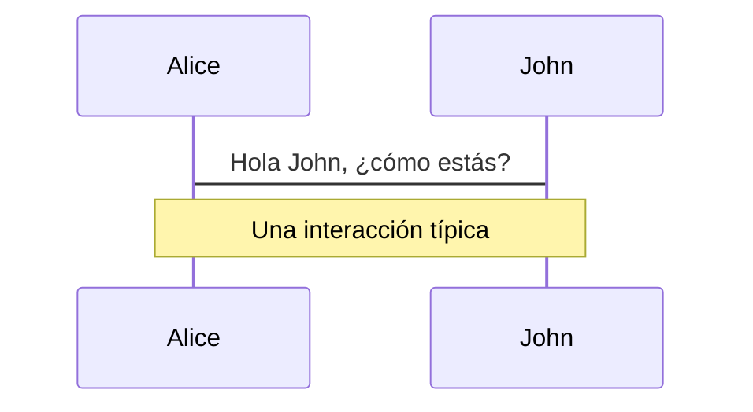
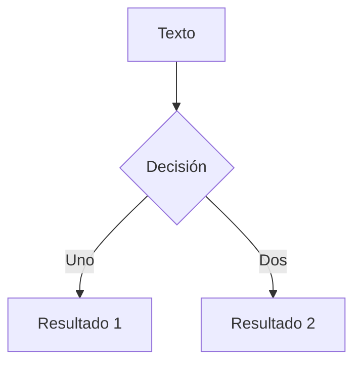
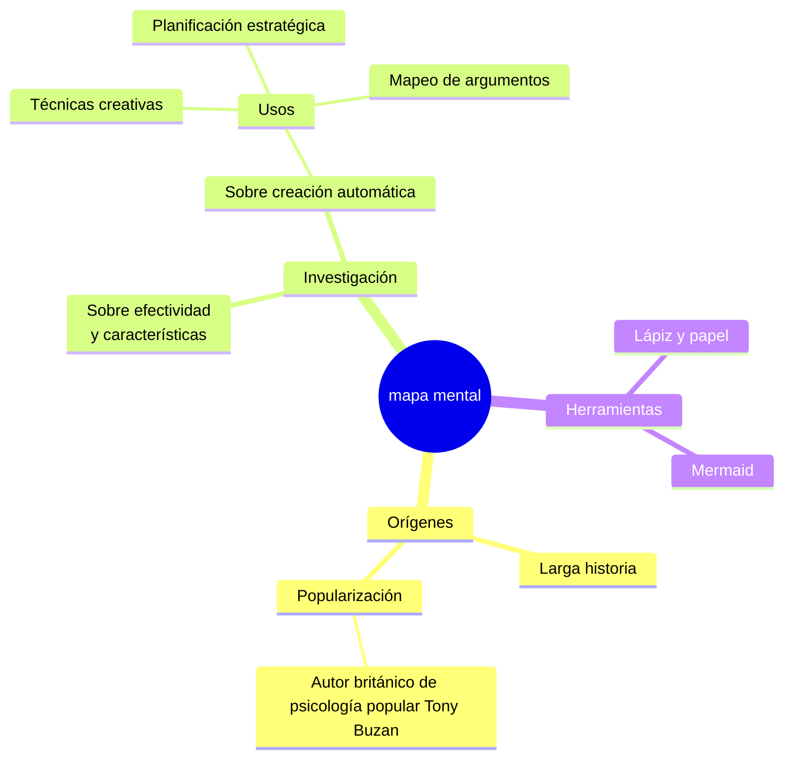
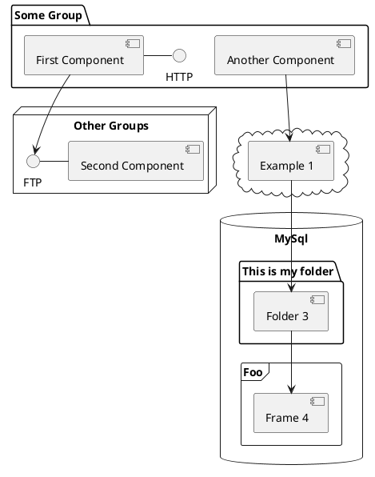

---
# try also 'default' to start simple
theme: seriph
# random image from a curated Unsplash collection by Anthony
# like them? see https://unsplash.com/collections/94734566/slidev
background: https://cover.sli.dev
# some information about your slides (markdown enabled)
title: Bienvenido a Slidev
info: |
  ## Plantilla Inicial de Slidev
  Presentaciones para desarrolladores.

  Aprende más en [Sli.dev](https://sli.dev)
# apply UnoCSS classes to the current slide
class: text-center
# https://sli.dev/features/drawing
drawings:
  persist: false
# slide transition: https://sli.dev/guide/animations.html#slide-transitions
transition: slide-left
# enable MDC Syntax: https://sli.dev/features/mdc
mdc: false
# duration of the presentation
duration: 35min
---

# Bienvenido a Slidev

Presentaciones para desarrolladores

<div @click="$slidev.nav.next" class="mt-12 py-1" hover:bg="white op-10">
  Presiona Espacio para la siguiente página <carbon:arrow-right />
</div>

<div class="abs-br m-6 text-xl">
  <button @click="$slidev.nav.openInEditor()" title="Abrir en Editor" class="slidev-icon-btn">
    <carbon:edit />
  </button>
  <a href="https://github.com/slidevjs/slidev" target="_blank" class="slidev-icon-btn">
    <carbon:logo-github />
  </a>
</div>

<!--
El último bloque de comentarios de cada diapositiva se tratará como notas de diapositiva. Será visible y editable en el Modo Presentador junto con la diapositiva. [Lee más en la documentación](https://sli.dev/guide/syntax.html#notes)
-->

---
transition: fade-out
---

# ¿Qué es Slidev?

Slidev es un creador y presentador de diapositivas diseñado para desarrolladores, que consta de las siguientes características

- 📝 **Basado en texto** - enfócate en el contenido con Markdown, y luego estilízalo después
- 🎨 **Temático** - los temas pueden compartirse y reutilizarse como paquetes npm
- 🧑‍💻 **Amigable para desarrolladores** - resaltado de código, codificación en vivo con autocompletado
- 🤹 **Interactivo** - integra componentes Vue para mejorar tus expresiones
- 🎥 **Grabación** - grabación integrada y vista de cámara
- 📤 **Portable** - exporta a PDF, PPTX, PNGs, o incluso una SPA alojable
- 🛠 **Personalizable** - prácticamente todo lo que es posible en una página web es posible en Slidev

- Es la mejor herramienta para realizar presentaciones
<br>
<br>

Lee más sobre [¿Por qué Slidev?](https://sli.dev/guide/why)

<!--
Puedes tener una etiqueta `style` en markdown para sobrescribir el estilo de la página actual.
Aprende más: https://sli.dev/features/slide-scope-style
-->

<style>
h1 {
  background-color: #2B90B6;
  background-image: linear-gradient(45deg, #4EC5D4 30%, #146b8c 80%);
  background-size: 100%;
  -webkit-background-clip: text;
  -moz-background-clip: text;
  -webkit-text-fill-color: transparent;
  -moz-text-fill-color: transparent;
}
</style>

<!--
Aquí hay otro comentario.
-->

---
transition: slide-up
level: 2
---

# Navigation

Hover on the bottom-left corner to see the navigation's controls panel, [learn more](https://sli.dev/guide/ui#navigation-bar)

## Keyboard Shortcuts

|                                                     |                             |
| --------------------------------------------------- | --------------------------- |
| <kbd>right</kbd> / <kbd>space</kbd>                 | next animation or slide     |
| <kbd>left</kbd>  / <kbd>shift</kbd><kbd>space</kbd> | previous animation or slide |
| <kbd>up</kbd>                                       | previous slide              |
| <kbd>down</kbd>                                     | next slide                  |

<!-- https://sli.dev/guide/animations.html#click-animation -->

<p v-after class="absolute bottom-23 left-45 opacity-30 transform -rotate-10">¡Aquí!</p>

---
layout: two-cols
layoutClass: gap-16
---

# Tabla de contenidos

Puedes usar el componente `Toc` para generar una tabla de contenidos para tus diapositivas:

```html
<Toc minDepth="1" maxDepth="1" />
```

El título se inferirá del contenido de tu diapositiva, o puedes sobrescribirlo con `title` y `level` en tu frontmatter.

::right::

<Toc text-sm minDepth="1" maxDepth="2" />

---
layout: image-right
image: https://cover.sli.dev
---

# Código

Usa fragmentos de código y obtén el resaltado directamente, ¡e incluso información al pasar el mouse!

```ts [filename-example.ts] {all|4|6|6-7|9|all} twoslash
// TwoSlash habilita información de hover de TypeScript
// y errores en bloques de código markdown
// Más en https://shiki.style/packages/twoslash
import { computed, ref } from 'vue'

const count = ref(0)
const doubled = computed(() => count.value * 2)

doubled.value = 2
```

<arrow v-click="[4, 5]" x1="350" y1="310" x2="195" y2="342" color="#953" width="2" arrowSize="1" />

<!-- Esto te permite integrar bloques de código externos -->
<<< @/snippets/external.ts#snippet

<!-- Pie de página -->

[Aprende más](https://sli.dev/features/line-highlighting)

<!-- Inline style -->
<style>
.footnotes-sep {
  @apply mt-5 opacity-10;
}
.footnotes {
  @apply text-sm opacity-75;
}
.footnote-backref {
  display: none;
}
</style>

<!--
Las notas también pueden sincronizarse con los clics

[click] Esto se resaltará después del primer clic

[click] Resaltado con `count = ref(0)`

[click:3] Último clic (saltar dos clics)
-->

---
level: 2
---

# Shiki Magic Move

Impulsado por [shiki-magic-move](https://shiki-magic-move.netlify.app/), Slidev admite animaciones entre múltiples fragmentos de código.

Agrega múltiples bloques de código y envuélvelos con <code>````md magic-move</code> (cuatro comillas invertidas) para habilitar el movimiento mágico. Por ejemplo:

````md magic-move {lines: true}
```ts {*|2|*}
// paso 1
const author = reactive({
  name: 'John Doe',
  books: [
    'Vue 2 - Guía Avanzada',
    'Vue 3 - Guía Básica',
    'Vue 4 - El Misterio'
  ]
})
```

```ts {*|1-2|3-4|3-4,8}
// paso 2
export default {
  data() {
    return {
      author: {
        name: 'John Doe',
        books: [
          'Vue 2 - Guía Avanzada',
          'Vue 3 - Guía Básica',
          'Vue 4 - El Misterio'
        ]
      }
    }
  }
}
```

```ts
// paso 3
export default {
  data: () => ({
    author: {
      name: 'John Doe',
      books: [
        'Vue 2 - Guía Avanzada',
        'Vue 3 - Guía Básica',
        'Vue 4 - El Misterio'
      ]
    }
  })
}
```

Los bloques que no son código se ignoran.

```vue
<!-- paso 4 -->
<script setup>
const author = {
  name: 'John Doe',
  books: [
    'Vue 2 - Guía Avanzada',
    'Vue 3 - Guía Básica',
    'Vue 4 - El Misterio'
  ]
}
</script>
```
````

---

# Componentes

<div grid="~ cols-2 gap-4">
<div>

Puedes usar componentes Vue directamente dentro de tus diapositivas.

Hemos proporcionado algunos componentes integrados como `<Tweet/>` y `<Youtube/>` que puedes usar directamente. Y agregar tus componentes personalizados también es súper fácil.

```html
<Counter :count="10" />
```

<!-- ./components/Counter.vue -->
<Counter :count="10" m="t-4" />

Consulta [las guías](https://sli.dev/builtin/components.html) para más información.

</div>
<div>

```html
<Tweet id="1390115482657726468" />
```

<Tweet id="1390115482657726468" scale="0.65" />

</div>
</div>

<!--
Nota del presentador con texto en **negrita**, *cursiva* y ~~tachado~~.

Además, los elementos HTML son válidos:
<div class="flex w-full">
  <span style="flex-grow: 1;">Contenido izquierdo</span>
  <span>Contenido derecho</span>
</div>
-->

---
class: px-20
---

# Temas

Slidev viene con un potente soporte de temas. Los temas pueden proporcionar estilos, diseños, componentes o incluso configuraciones para herramientas. Cambiar entre temas con solo **una edición** en tu frontmatter:

<div grid="~ cols-2 gap-2" m="t-2">

```yaml
---
theme: default
---
```

```yaml
---
theme: seriph
---
```


</div>

Lee más sobre [Cómo usar un tema](https://sli.dev/guide/theme-addon#use-theme) y
consulta la [Galería de Temas Impresionantes](https://sli.dev/resources/theme-gallery).

---

# Animaciones de Clics

Puedes agregar `v-click` a elementos para agregar una animación de clic.

<div v-click>

Esto aparece cuando haces clic en la diapositiva:

```html
<div v-click>Esto aparece cuando haces clic en la diapositiva.</div>
```

</div>

<br>

<v-click>

La directiva <span v-mark.red="3"><code>v-mark</code></span>
también te permite agregar
<span v-mark.circle.orange="4">marcas en línea</span>
, impulsada por [Rough Notation](https://roughnotation.com/):

```html
<span v-mark.underline.orange>marcadores en línea</span>
```

</v-click>

<div mt-20 v-click>

[Aprende más](https://sli.dev/guide/animations#click-animation)

</div>

---

# Movimientos

Las animaciones de movimiento están impulsadas por [@vueuse/motion](https://motion.vueuse.org/), activadas por la directiva `v-motion`.

```html
<div
  v-motion
  :initial="{ x: -80 }"
  :enter="{ x: 0 }"
  :click-3="{ x: 80 }"
  :leave="{ x: 1000 }"
>
  Slidev
</div>
```

<div class="w-60 relative">
  <div class="relative w-40 h-40">
    
    
    
  </div>

  <div
    class="text-5xl absolute top-14 left-40 text-[#2B90B6] -z-1"
    v-motion
    :initial="{ x: -80, opacity: 0}"
    :enter="{ x: 0, opacity: 1, transition: { delay: 2000, duration: 1000 } }">
    Slidev
  </div>
</div>

<!-- los scripts de vue script setup se pueden usar directamente en markdown, y solo afectarán la página actual -->
<script setup lang="ts">
const final = {
  x: 0,
  y: 0,
  rotate: 0,
  scale: 1,
  transition: {
    type: 'spring',
    damping: 10,
    stiffness: 20,
    mass: 2
  }
}
</script>

<div
  v-motion
  :initial="{ x:35, y: 30, opacity: 0}"
  :enter="{ y: 0, opacity: 1, transition: { delay: 3500 } }">

[Learn more](https://sli.dev/guide/animations.html#motion)

</div>

---

# $\LaTeX$

$\LaTeX$ está soportado de forma predeterminada. Impulsado por [$\KaTeX$](https://katex.org/).

<div h-3 />

En línea $\sqrt{3x-1}+(1+x)^2$

Bloque
$$ {1|3|all}
\begin{aligned}
\nabla \cdot \vec{E} &= \frac{\rho}{\varepsilon_0} \\
\nabla \cdot \vec{B} &= 0 \\
\nabla \times \vec{E} &= -\frac{\partial\vec{B}}{\partial t} \\
\nabla \times \vec{B} &= \mu_0\vec{J} + \mu_0\varepsilon_0\frac{\partial\vec{E}}{\partial t}
\end{aligned}
$$

[Aprende más](https://sli.dev/features/latex)

---

# Diagramas

Puedes crear diagramas / gráficos a partir de descripciones textuales, directamente en tu Markdown.

<div class="grid grid-cols-4 gap-5 pt-4 -mb-6">









</div>

Aprende más: [Diagramas Mermaid](https://sli.dev/features/mermaid) y [Diagramas PlantUML](https://sli.dev/features/plantuml)

---
foo: bar
dragPos:
  square: 691,32,167,_,-16
---

# Draggable Elements

Double-click on the draggable elements to edit their positions.

<br>

###### Directive Usage

```md

```

<br>

###### Component Usage

```md
<v-drag text-3xl>
  <div class="i-carbon:arrow-up" />
  Use the `v-drag` component to have a draggable container!
</v-drag>
```

<v-drag pos="663,206,261,_,-15">
  <div text-center text-3xl border border-main rounded>
    Double-click me!
  </div>
</v-drag>


###### Draggable Arrow

```md
<v-drag-arrow two-way />
```

<v-drag-arrow pos="67,452,253,46" two-way op70 />

---
src: ./pages/imported-slides.md
hide: false
---

---

# Editor Monaco

Slidev proporciona soporte integrado para el Editor Monaco.

Agrega `{monaco}` al bloque de código para convertirlo en un editor:

```ts {monaco}
import { ref } from 'vue'
import { emptyArray } from './external'

const arr = ref(emptyArray(10))
```

Usa `{monaco-run}` para crear un editor que pueda ejecutar el código directamente en la diapositiva:

```ts {monaco-run}
import { version } from 'vue'
import { emptyArray, sayHello } from './external'

sayHello()
console.log(`vue ${version}`)
console.log(emptyArray<number>(10).reduce(fib => [...fib, fib.at(-1)! + fib.at(-2)!], [1, 1]))
```

---
layout: center
class: text-center
---

# Aprende Más

[Documentación](https://sli.dev) · [GitHub](https://github.com/slidevjs/slidev) · [Muestras](https://sli.dev/resources/showcases)

<PoweredBySlidev mt-10 />
